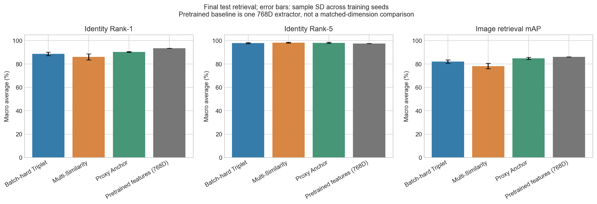

# Reported results snapshot

These values were supplied from the completed fresh annotation-driven experiment **before the packaging refactor**. They document that experiment, not the synthetic tests and not a promise of identical results for a new run. The architecture, losses, preprocessing, sampling and metric formulas are preserved by this refactor. Run configurations, manifests, checkpoints and full evaluation outputs remain necessary for independently reproducing the numbers; those large/local artifacts are not bundled.

The scored partition contained 33 annotation identity IDs, 66 gallery images (two per identity), and 436 queries. Metrics below are macro-averaged over identities. Fine-tuned values are means ± sample SD over three training seeds. The pretrained reference is one fixed extractor.

| Configuration | Dimensions | Rank-1 (%) | Rank-5 (%) | mAP (%) |
|---|---:|---:|---:|---:|
| Batch-hard Triplet | 128 | 88.58 ± 1.46 | 97.77 ± 0.54 | 82.07 ± 1.37 |
| Multi-Similarity | 128 | 86.06 ± 2.54 | **98.21 ± 0.34** | 78.20 ± 2.33 |
| Proxy Anchor | 128 | **90.24 ± 0.38** | 98.11 ± 0.52 | **84.70 ± 0.93** |
| Pretrained features (separate reference) | 768 | 93.38 | 97.50 | 86.13 |

Proxy Anchor improved mean Rank-1 by 1.66 percentage points and mAP by 2.63 points relative to the tested Triplet configuration. It also had lower Rank-1/mAP seed variation. Multi-Similarity had a small Rank-5 advantage, but weaker primary retrieval metrics.

None of the fine-tuned configurations exceeded the pretrained reference on Rank-1 or mAP. Its 768D representation differs from the trained 128D embeddings; this comparison cannot isolate fine-tuning from dimensionality/projection. Higher dimensionality is not itself proof of superiority. Seed SD is not statistical significance.

The supplied protocol metadata still recorded manual gallery/query review as pending and capture-session separation as unverified. These limitations must be retained unless independently resolved. This is closed-gallery retrieval on a custom split from the labeled pool, not official competition scoring or unknown-tiger rejection.
